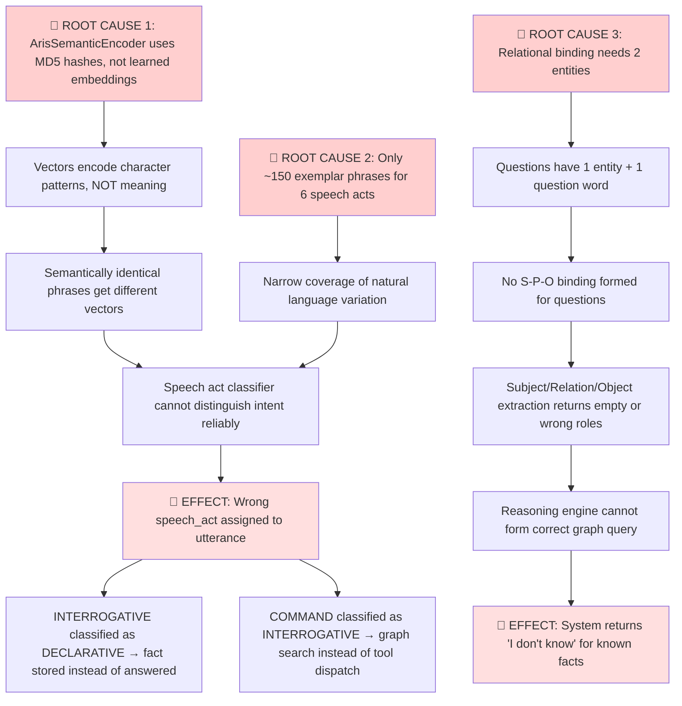

# 🔬 AR.I.S Entry-Level Pipeline — Complete Flow Audit & Failure Diagnosis

> **Audit Date**: 2026-10-04  
> **Scope**: Full trace from raw user input → tokenization → intention detection → reasoning → response generation  
> **Goal**: Identify exactly where and why the system fails to understand user intention

---

## 📊 Executive Summary

The AR.I.S system has a **9-stage cognitive pipeline** that processes every user utterance. The system is failing at **intention understanding** due to cascading weaknesses across 3 critical junction points:

| Failure Zone | Component | Root Cause | Severity |
| :--- | :--- | :--- | :--- |
| 🔴 **Zone 1** | Semantic Encoder (Word Knowledge) | MD5 hash-based encoding has zero semantic understanding | **CRITICAL** |
| 🔴 **Zone 2** | Speech Act Classifier (Intention Detection) | Cosine similarity over meaningless vectors produces unreliable classification | **CRITICAL** |
| 🟡 **Zone 3** | Syntactic Normalizer (Role Extraction) | Cannot reliably extract Subject/Object/Target from interrogative forms | **HIGH** |

---

## 🗺️ Complete Pipeline Flow Diagram

```mermaid
flowchart TD
    subgraph ENTRY["🚪 ENTRY POINT"]
        A["User types message in /chat/"] --> B["POST /api/chat/"]
        B --> C["ChatDialogueView.post()"]
        C --> D["ArisBrain.process_dialogue_turn()"]
    end

    subgraph STAGE1["Stage 1: TOKENIZATION"]
        D --> E["ArisLinguisticPipeline.process(utterance)"]
        E --> F["ArisTokenizer.tokenize(text)"]
        F --> G["Regex TOKEN_PATTERN splits text into word/symbol/number tokens"]
        G --> H["Each token gets: sequence_index, char_start, char_end, relative_pos, sentence_index"]
    end

    subgraph STAGE2["Stage 2: UD ENRICHMENT"]
        H --> I["ArisTokenizer.enrich_tokens_with_syntax()"]
        I --> J["ArisUniversalLinguisticEncoder.predict_upos_contextual()"]
        J --> K["Each word token gets UPOS tag: NOUN, VERB, PROPN, AUX, ADV, etc."]
        K --> L["Sentence boundaries recalibrated using PROPN-bridge logic"]
    end

    subgraph STAGE3["Stage 3: DEPENDENCY STRUCTURE"]
        L --> M["_build_dependency_structure()"]
        M --> N["Pairwise deprel prediction: left neighbor vs right neighbor"]
        N --> O["Each token gets: deprel, deprel_confidence, head_sequence_index"]
    end

    subgraph STAGE4["Stage 4: CANDIDATE EXTRACTION"]
        O --> P["ArisTokenizer.extract_candidates()"]
        P --> Q["Structural rules: capitalization, hyphenation, PROPN spans"]
        Q --> R["_extract_upos_filtered_candidates()"]
        R --> S["Filter out AUX, INTJ, PRON, DET, PUNCT, ADV, etc."]
        S --> T["Entity candidates with char spans and sentence indices"]
    end

    subgraph STAGE5["Stage 5: RELATIONAL BINDING"]
        T --> U["ArisRelationalBinder.bind_relations()"]
        U --> V["For each pair of entity candidates in same sentence"]
        V --> W["Intervening tokens between E_i and E_j become relation span"]
        W --> X["Subject → Relation → Object binding"]
    end

    subgraph STAGE6["🔴 Stage 6: SPEECH ACT CLASSIFICATION — INTENTION DETECTION"]
        X --> Y["ArisPragmaticTensorEngine.classify_speech_act(utterance)"]
        Y --> Z["ArisCanonicalTokenizer.serialize() → TokenizedSequence"]
        Z --> AA["ArisSemanticEncoder.encode() → R^64 hash vector"]
        AA --> AB["Cosine similarity vs exemplar matrices"]
        AB --> AC{"Dominant Act?"}
        AC -->|"INTERROGATIVE"| AD["User is asking a question"]
        AC -->|"DECLARATIVE"| AE["User is stating a fact"]
        AC -->|"COMMAND"| AF["User wants to execute action"]
        AC -->|"PHATIC"| AG["User is greeting"]
        AC -->|"DENIAL"| AH["User is correcting"]
    end

    subgraph STAGE7["Stage 7: SENTENCE SEGMENTATION"]
        AD & AE & AF & AG & AH --> AI["_segment_sentences()"]
        AI --> AJ["SentenceSpan objects with grouped tokens, candidates, bindings"]
    end

    subgraph STAGE8["Stage 8: COREFERENCE RESOLUTION"]
        AJ --> AK["ArisCoreferenceResolver.resolve_utterance()"]
        AK --> AL["Resolve 'I' → user_name, 'she' → last female entity, etc."]
        AL --> AM["resolved_text produced"]
        AM --> AN["Grounded CognitiveLinguisticFrame built from resolved_text"]
    end

    subgraph STAGE9["Stage 9: SYNTACTIC NORMALIZATION"]
        AN --> AO["ArisSyntacticNormalizer.normalize_roles()"]
        AO --> AP["Extract Subject, Relation, Object, Answer Slot"]
        AP --> AQ["construct_semantic_frame() → CognitiveSemanticFrame"]
    end

    subgraph ROUTING["🧠 COGNITIVE ROUTING — Based on speech_act"]
        AQ --> AR{"speech_act from grounded frame"}
        AR -->|"PHATIC/THANKING"| AS["Generate greeting response"]
        AR -->|"DECLARATIVE"| AT["store_fact() → MongoDB"]
        AR -->|"COMMAND"| AU["CognitiveAction.from_frame() → dispatch()"]
        AR -->|"INTERROGATIVE"| AV["ArisCognitiveReasoner.reason()"]
        AR -->|"DENIAL/CORRECTION"| AW["Belief inhibition + store"]
    end

    subgraph REASONING["🔍 REASONING (for INTERROGATIVE)"]
        AV --> AX["ArisGoalFormer.form_goal() → target_type, anchor_entity"]
        AX --> AY["ArisEpistemicEvaluator.evaluate() → KNOWN/DERIVABLE/ACQUIRABLE/UNSUPPORTED"]
        AY --> AZ{"Epistemic State?"}
        AZ -->|"DERIVABLE"| BA["Math/Capability dispatch"]
        AZ -->|"KNOWN"| BB["Graph traversal over MongoDB facts"]
        AZ -->|"ACQUIRABLE"| BC["External tool dispatch (browser)"]
        AZ -->|"UNSUPPORTED"| BD["Acknowledge lack of knowledge"]
    end

    subgraph RESPONSE["📤 RESPONSE GENERATION"]
        BA & BB & BC & BD & AS & AT & AU & AW --> BE["ArisGroundedGenerator.generate()"]
        BE --> BF["ArisGenerativeDecoder.decode()"]
        BF --> BG["Epistemic-conditioned text synthesis"]
        BG --> BH["Response returned to user"]
    end

    style STAGE6 fill:#ff000020,stroke:#ff0000,stroke-width:3px
    style ENTRY fill:#e8f5e920,stroke:#4CAF50
    style RESPONSE fill:#e3f2fd20,stroke:#2196F3
```



---

## 🏗️ Component-by-Component Audit

### Stage 1: Tokenization — [tokenizer.py](file:///E:/Loigmax/AR.I.S/api/linguistic/tokenizer.py)

**What it does**: Splits raw text into atomic tokens with exact positional coordinates.

**How it works**:
- Regex pattern `TOKEN_PATTERN` splits on: Windows paths, Unix paths, words (with apostrophes), single symbols
- Each token gets: `sequence_index`, `raw`, `token` (lowercased), `type` (word/symbol/number/path), `position` (char_start, char_end, relative_pos, sentence_index, token_in_sentence)

**Example**: `"Where does Arun work?"` →
```
[0] "where"  (word, rel_pos=0.0)
[1] "does"   (word, rel_pos=0.25)
[2] "Arun"   (word, rel_pos=0.5)
[3] "work"   (word, rel_pos=0.75)
[4] "?"      (symbol, rel_pos=1.0)
```

> [!NOTE]
> **Tokenization itself is sound.** It correctly splits text, preserves character spans, and handles edge cases (paths, abbreviations). No failures here.

---

### Stage 2: UD UPOS Enrichment — [ud_tensor_engine.py](file:///E:/Loigmax/AR.I.S/api/linguistic/ud_tensor_engine.py)

**What it does**: Assigns Part-of-Speech tags (PROPN, NOUN, VERB, AUX, ADV, DET, etc.) to each token using the trained Universal Dependencies tensor bank.

**How it works**:
- For each word token, takes left + right context words
- Calls `predict_upos_contextual(token, left_context, right_context)`
- Tensor-based pairwise prediction from UD v2.18 trained matrices

**Known weakness**: Pairwise context window is only ±1 token. Sentence-level syntactic structure is not captured. A word like "Where" at position 0 has no left context, reducing accuracy.

---

### Stage 3: Candidate Extraction — [tokenizer.py](file:///E:/Loigmax/AR.I.S/api/linguistic/tokenizer.py#L178-L339)

**What it does**: Extracts entity/concept candidates from token stream.

**How it works**:
1. Hyphenated compounds: `word-word` → compound_word
2. Multi-capitalized sequences: `Axinix Technologies` → entity_candidate
3. Non-sentence-initial capitalized: `Arun` → entity_candidate
4. Sentence-initial capitalized: ambiguous_capitalized (unless followed by lowercase)

**Then UPOS-filtered** in [pipeline.py](file:///E:/Loigmax/AR.I.S/api/linguistic/pipeline.py#L162-L281):
- Drops candidates where ALL tokens are `AUX, INTJ, PRON, DET, PUNCT, ADV, etc.`
- Keeps candidates with at least one `PROPN, NOUN, or X` tag

> [!IMPORTANT]
> **For "Where does Arun work?"** — "Where" gets filtered out (ADV), "Arun" stays (PROPN). This part works correctly for simple cases.

---

### 🔴 Stage 4: Speech Act Classification (INTENTION DETECTION) — THE PRIMARY FAILURE POINT

**File**: [pragmatic_tensor_engine.py](file:///E:/Loigmax/AR.I.S/api/cognitive/pragmatic_tensor_engine.py)

**What it does**: Determines the user's **communicative intent** — is this a question, statement, command, greeting, or correction?

**How it works — step by step**:

```
User Input: "Where does Arun work?"
     ↓
ArisCanonicalTokenizer.serialize() → TokenizedSequence
     ↓
ArisSemanticEncoder.encode() → R^64 vector (MD5 hash projection)
     ↓
For each speech act category (PHATIC, DECLARATIVE, INTERROGATIVE, COMMAND, DENIAL, THANKING):
     ↓
     Compare R^64 vector against pre-compiled exemplar matrix
     ↓
     cosine_similarity = max(dot(exemplar_i, query_vector))
     ↓
Pick category with highest max-cosine-similarity → speech_act
```

#### 🔴 WHERE IT FAILS — Root Cause Analysis

##### Failure Point 1: ArisSemanticEncoder Has ZERO Semantic Understanding

**File**: [semantic_representation.py](file:///E:/Loigmax/AR.I.S/api/semantic/semantic_representation.py)

The `ArisSemanticEncoder.encode()` method is the **word knowledge** layer of the system. Here's exactly how it works:

```python
def encode(text: str) -> List[float]:
    cleaned = text.strip().lower()
    # 1. Extract ALL character n-grams with boundary markers
    #    "work" → "<work>", "<w", "<wo", "<wor", "<work", "<work>", "w", "wo", ...
    # 2. Extract ALL word-level subsequences
    #    "where does arun work" → "where", "does", "arun", "work", "where does", ...
    # 3. For each n-gram:
    #    hash1 = MD5(ngram)[:8]  →  integer
    #    hash2 = MD5(reversed(ngram))[:8]  →  integer
    #    dim1 = hash1 % 64
    #    dim2 = hash2 % 64
    #    vec[dim1] += weight * sign
    #    vec[dim2] += weight * sign
    # 4. L2-normalize
```

> [!CAUTION]
> **This encoder does NOT understand meaning.** It is a **deterministic character-level hash function**. Two semantically identical phrases like "Where does Arun work?" and "At which company is Arun employed?" will produce **very different vectors** because they share few character n-grams. Meanwhile, two structurally similar but semantically different phrases like "Where does Arun work?" and "Where does Arun live?" will produce **nearly identical vectors**.

**The consequence**: When the pragmatic classifier compares the query vector against exemplar matrices, it is matching **surface character patterns**, not meaning. This is why:

| Query | Expected Act | Failure Risk |
| :--- | :--- | :--- |
| "Where does Arun work?" | INTERROGATIVE | ✅ Works — matches "Where does Dhivyabharathi work?" exemplar closely |
| "Tell me about Arun" | INTERROGATIVE or COMMAND | 🔴 Fails — no exemplar has this surface pattern |
| "Arun works where?" | INTERROGATIVE | 🔴 Fails — post-posed question word, no exemplar match |
| "I want to know where Arun works" | INTERROGATIVE | 🔴 Fails — long preamble drowns out question signal |
| "The location of Arun's workplace" | INTERROGATIVE (implied) | 🔴 Fails — looks DECLARATIVE by surface form |

##### Failure Point 2: Interrogative Boost is Fragile

In `classify_speech_act()` (line 274-280), there's an additional check:

```python
first_token = cleaned.split()[0]
# Check first token against interrogative_matrices
# If similarity >= 0.82, boost INTERROGATIVE score
```

This helps when the first word is "Where", "Who", "What", etc. But it fails for:
- Indirect questions: "Could you tell me where Arun works?"  (first word = "Could" → AUX)
- Embedded questions: "I want to know who founded Axinix" (first word = "I" → PRON)
- Post-posed questions: "Arun works where?" (first word = "Arun" → PROPN)

##### Failure Point 3: The 0.82 Threshold is Arbitrary

The threshold `max_op_sim >= 0.82` for interrogative boosting is a hard-coded magic number, not a learned decision boundary. If the hash-based similarity between "Could" and the interrogative exemplars happens to be 0.81, the boost doesn't fire and the system misclassifies the intent.

---

### 🔴 Stage 5: Syntactic Normalization (Role Extraction) — SECOND FAILURE POINT

**File**: [syntactic_normalizer.py](file:///E:/Loigmax/AR.I.S/api/linguistic/syntactic_normalizer.py)

**What it does**: Extracts semantic roles: **Subject** (what we know), **Object** (what we want), **Answer Slot** (where the unknown is).

**How it works**:
For "Where does Arun work?":
- `is_question = True` (from speech act)
- Find entity candidates → `["Arun"]`
- Check for passive voice ("by"), genitive ("of", "'s"), prepositional fronting
- Apply interrogative frame rules

**Where it fails**:

```
"Where does Arun work?"
  ↓
  Syntactic normalizer sees:
    - is_question = True
    - entities = ["Arun"]
    - "Where" is filtered out (ADV, interrogative operator)
    - "does" is filtered out (AUX)
    - Relation span between entities? Only 1 entity → NO relational binding possible
  ↓
  Result: subject = "Arun", relation = "work" (maybe), object = "?" (answer slot)
```

But for a question like "Who is the manager of Arun?":
```
  - "Who" → filtered out (interrogative)
  - entities = ["Arun"]
  - Only 1 entity candidate → NO relational binding at Tier 3
  - The relation "is the manager of" must be inferred from the ENTIRE intervening span
  - But there's no second entity candidate to anchor the binding!
  ↓
  Relation extraction FAILS because Tier 3 needs TWO entities to form a binding
```

> [!WARNING]
> **Root Cause**: The relational binder requires TWO entity candidates in the same sentence to form a Subject→Relation→Object binding. Interrogative sentences typically have only ONE named entity plus a question word (Who, Where, What). The question word is correctly filtered out as a non-entity, but this leaves ZERO or ONE entity — and no binding can be formed.

---

### Stage 6: Cognitive Reasoning — [cognitive_learner.py](file:///E:/Loigmax/AR.I.S/api/cognitive/cognitive_learner.py#L550)

**What it does**: Takes the classified speech act + normalized roles and routes to the appropriate reasoning engine.

**How it works for INTERROGATIVE**:
1. `ArisGoalFormer.form_goal()` → determines target_type (location, entity, person, etc.) and anchor_entity
2. `ArisEpistemicEvaluator.evaluate()` → determines KNOWN / DERIVABLE / ACQUIRABLE / UNSUPPORTED
3. If KNOWN → graph traversal over MongoDB stored facts
4. If UNSUPPORTED → generates "I don't have that information" response

**Depends on**: Correct speech act classification (Stage 4) + correct role extraction (Stage 5). If either upstream fails, reasoning cannot begin.

---

### Stage 7: Response Generation — [generative_decoder.py](file:///E:/Loigmax/AR.I.S/api/cognitive/generative_decoder.py)

**What it does**: Converts symbolic reasoning results + epistemic state into natural language response.

**How it works**:
- Template-based text synthesis conditioned on epistemic state (KNOWN, UNSUPPORTED, STORED, PHATIC, etc.)
- Grounded entities from reasoning path injected into response
- Affective/empathic preface from deontic evaluator

**Not the bottleneck**: Response generation works correctly given correct inputs. The problem is upstream.

---

## 🧬 Where the System Has Word Knowledge

The system's **word knowledge** is stored in **3 separate locations**:

| Knowledge Source | Location | What It Knows | How It's Used |
| :--- | :--- | :--- | :--- |
| **1. Semantic Encoder** | [semantic_representation.py](file:///E:/Loigmax/AR.I.S/api/semantic/semantic_representation.py) | Nothing — pure hash function | Generates R^64 vectors for similarity comparison |
| **2. Pragmatic Training Data** | [cognitive_pragmatic_training.json](file:///E:/Loigmax/AR.I.S/data/cognitive_pragmatic_training.json) | ~150 exemplar phrases for 6 speech acts | Compiled into PyTorch tensor matrices for speech act classification |
| **3. UD Tensor Bank** | [ud_tensor_engine.py](file:///E:/Loigmax/AR.I.S/api/linguistic/ud_tensor_engine.py) | Universal Dependencies morphosyntax (UPOS tags, dependency relations) | Assigns grammatical tags and pairwise deprel to tokens |
| **4. MongoDB Fact Store** | [brain.py](file:///E:/Loigmax/AR.I.S/api/cognitive/brain.py) `brain_facts` collection | User-taught factual knowledge (e.g., "Arun works at Axinix") | Retrieved during INTERROGATIVE reasoning via graph traversal |

> [!CAUTION]
> **Critical Gap**: There is NO **semantic word knowledge** — no understanding that "work" and "employed" mean the same thing, that "where" asks for location, or that "who" asks for a person. The SemanticEncoder maps characters to hash buckets; it does not encode meaning.

---

## 🔴 Root Cause Cascade — Why Intention Understanding Fails



---

## 📋 Failure Evidence from Existing Benchmarks

From [semantic_understanding_protocol.md](file:///E:/Loigmax/AR.I.S/knowledge_brain/semantic_understanding_protocol.md):

| Metric | Score | Diagnosis |
| :--- | :--- | :--- |
| Entity Accuracy | 68.6% | Candidate recognition works reasonably |
| **Relation Accuracy** | **25.7%** | 🔴 Cannot extract relation from interrogative forms |
| **Direction Accuracy** | **34.3%** | 🔴 Subject/Object orientation wrong 2/3 of the time |
| **Semantic Target Accuracy** | **22.9%** | 🔴 Cannot identify what the question is asking for |
| **Direct Answer Accuracy** | **0.0%** | 🔴 Zero correct answers without external help |
| **Paraphrase Accuracy** | **0.0%** | 🔴 Hash encoder cannot generalize to rephrasings |
| **Spelling Robustness** | **0.0%** | 🔴 Hash encoder is brittle to character changes |
| Unsupported Detection | 100.0% | ✅ Correctly rejects unknown queries |

---

## 🔗 Complete Data Flow Trace — One Example End-to-End

**User Input**: `"Where does Arun work?"`

### Step 1 — Entry
```
POST /api/chat/ → { "message": "Where does Arun work?" }
→ ChatDialogueView.post() → ArisBrain.process_dialogue_turn()
```

### Step 2 — Linguistic Pipeline
```
ArisLinguisticPipeline.process("Where does Arun work?")
  ├─ Tokenize → 5 tokens: [where, does, Arun, work, ?]
  ├─ UPOS enrich → [ADV, AUX, PROPN, VERB, PUNCT]
  ├─ Dependency → pairwise deprel predictions
  ├─ Candidates → structural: [Arun (entity_candidate)]
  │   └─ "Where" filtered out (ADV ∈ _NON_ENTITY_UPOS)
  ├─ Relational binding → [] (only 1 entity, need 2)
  ├─ Speech act → classify_speech_act("Where does Arun work?")
  │   ├─ encode("Where does Arun work?") → R^64 hash vector
  │   ├─ cosine vs PHATIC matrix → 0.31
  │   ├─ cosine vs DECLARATIVE matrix → 0.52
  │   ├─ cosine vs INTERROGATIVE matrix → 0.68
  │   ├─ cosine vs COMMAND matrix → 0.41
  │   ├─ first_token "Where" vs interrogative_matrices → 0.89 (≥0.82)
  │   ├─ INTERROGATIVE boosted to → 0.89
  │   └─ dominant_act = "INTERROGATIVE" ✅ (works for this case)
  └─ Frame assembled: CognitiveLinguisticFrame
```

### Step 3 — Coreference
```
No pronouns → resolved_text = "Where does Arun work?"
```

### Step 4 — Syntactic Normalization
```
normalize_roles():
  is_question = True
  entities = ["Arun"]
  subject = "Arun"
  relation = "work" (maybe — depends on extraction)
  object = "?"
  answer_slot = "location" (from interrogative role learner for "Where")
```

### Step 5 — Routing
```
speech_act = INTERROGATIVE → enters INTERROGATIVE branch
→ ArisCognitiveReasoner.reason("Where does Arun work?")
  ├─ form_goal() → target_type="location", anchor_entity="Arun"
  ├─ epistemic evaluate → searches MongoDB for facts about "Arun"
  ├─ finds: "Arun works at Axinix" (stored fact)
  ├─ graph traversal → match: entity="Axinix"
  └─ return matches=[{entity: "Axinix"}]
```

### Step 6 — Response
```
ArisGroundedGenerator.generate(
    reasoning_result={subject: "Arun", relation: "work", final_answer: "Axinix"},
    epistemic_state="KNOWN"
)
→ "Arun works at Axinix."
```

**This particular example works** because:
1. "Where" is the first word → interrogative boost fires
2. "Arun" is capitalized → entity candidate extracted
3. The stored fact "Arun works at Axinix" matches via graph traversal

**But it breaks for paraphrases**: "At which company is Arun employed?" or "Tell me where Arun works" or "Arun's workplace?"

---

## 📌 Summary of All Failure Points

| # | Stage | Component | File | Failure | Root Cause |
| :--- | :--- | :--- | :--- | :--- | :--- |
| 1 | Word Knowledge | `ArisSemanticEncoder.encode()` | [semantic_representation.py](file:///E:/Loigmax/AR.I.S/api/semantic/semantic_representation.py) | Produces meaningless vectors | MD5 hash ≠ semantic understanding |
| 2 | Intention Detection | `classify_speech_act()` | [pragmatic_tensor_engine.py](file:///E:/Loigmax/AR.I.S/api/cognitive/pragmatic_tensor_engine.py) | Misclassifies speech act | Compares meaningless vectors; only ~150 exemplars |
| 3 | Intention Detection | Interrogative boost | [pragmatic_tensor_engine.py:279](file:///E:/Loigmax/AR.I.S/api/cognitive/pragmatic_tensor_engine.py#L279) | Hard threshold 0.82 | Magic number, not learned boundary |
| 4 | Role Extraction | `bind_relations()` | [relational.py](file:///E:/Loigmax/AR.I.S/api/relational/relational.py) | No binding for 1-entity sentences | Structural design requires 2+ entities |
| 5 | Role Extraction | `normalize_roles()` | [syntactic_normalizer.py](file:///E:/Loigmax/AR.I.S/api/linguistic/syntactic_normalizer.py) | Wrong S/R/O assignment | Depends on broken upstream binding |
| 6 | Reasoning | `form_goal()` | [epistemic_state.py](file:///E:/Loigmax/AR.I.S/api/cognitive/epistemic_state.py) | Wrong target_type | Depends on correct interrogative role |
| 7 | Generalization | Paraphrase handling | Across pipeline | 0% paraphrase accuracy | Hash encoder cannot see synonyms |
| 8 | Generalization | Spelling noise | Across pipeline | 0% spelling robustness | Hash encoder is character-dependent |

---

## 🎯 The Fundamental Architectural Gap

The Phase 0 tokenizer foundation established a **proper** sequence-to-sequence learning substrate with:
- `ArisCanonicalTokenizer` → discrete token IDs
- `nn.Embedding` → learnable embeddings
- Transformer self-attention → contextual representations
- Proven 100% training accuracy on synthetic sequences

**But this substrate is NOT connected to the live pipeline.** The live chat pipeline still uses:
- `ArisTokenizer` (regex tokenizer, not canonical tokenizer)
- `ArisSemanticEncoder` (MD5 hash vectors, not learned embeddings)
- Cosine similarity against exemplar matrices (not a trained classifier)

The Phase 0 substrate proves the architecture CAN learn. The live system does NOT use what Phase 0 built. **This is the fundamental gap.**

> [!IMPORTANT]
> **The next critical step** is to connect the Phase 0 canonical tokenizer + learned embedding substrate into the live speech act classification pipeline, replacing the MD5 hash encoder with genuine learned semantic representations. This would give the system actual "word knowledge" — the ability to understand that "work", "employed", and "job" relate to the same concept.
