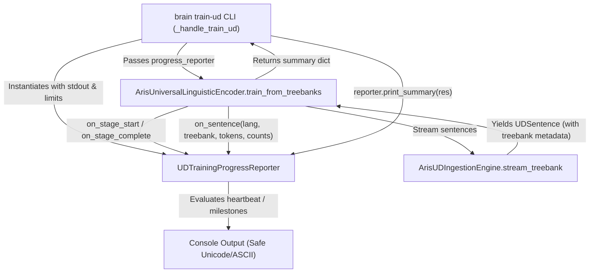

# Universal Dependencies Training Observability & Progress Diagnostics

## 1. Architectural Intent & Scope

The Universal Dependencies (UD v2.18) linguistic training command (`python manage.py brain train-ud`) streams multi-language CoNLL-U treebanks and compiles PyTorch metric tensor manifolds. Previously, the pipeline executed with a single static banner:

```text
[1/2] Streaming CoNLL-U Treebanks & Compiling PyTorch Metric Tensors...
```

For large training runs (e.g. 5 languages, 42,500 sentences, >600,000 tokens), the process ran for 8 to 15 minutes with no indication of active progress, rate, language transitions, or time remaining.

This enhancement introduces a **decoupled, non-intrusive observability layer** that provides real-time progress cards, periodic heartbeats, stage transitions, and completion summaries while strictly preserving:
- Zero changes to sampling limits, dataset filtering, or treebank selection.
- Zero changes to tensor compilation, mathematical manifolds, or dimensionality.
- Zero changes to exemplar generation or feature representations.
- Zero changes to model architecture or persistence format (`models/aris_ud_tensor_bank.pt`).

---

## 2. Decoupled Progress Architecture

The progress subsystem is implemented via an Observer pattern encapsulated in [ud_progress.py](file:///e:/Loigmax/AR.I.S/api/linguistic/ud_progress.py) via `UDTrainingProgressReporter`:



### Key Capabilities
1. **Dynamic Treebank Detection**: Inspects the stream archive member or supplemental file and attaches the active treebank identifier (e.g., `en_ewt`, `ud_supplemental`) to `UDSentence.metadata`.
2. **Dual-Scope Progress Tracking**: Displays both Language-level (`curr_lang_sentences / max_sentences_per_lang`) and Global-level (`total_sentences / total_target`) progress.
3. **Rate & ETA Estimation**: Dynamically calculates sentences/second rolling rates and projected time to completion (`ETA = remaining_sentences / rate`).
4. **Heartbeat & Milestone Triggering**: Emits periodic progress updates every 5.0 seconds without spamming the terminal, plus milestone ticks on treebank changes and exact limit completion.
5. **Console Encoding Safety**: Automatically detects console capabilities (`cp1252`, `cp437`, `utf-8`) and safely converts Unicode symbols (`✓` -> `[OK]`, `━` -> `=`) to prevent Windows `charmap` codec crashes.
6. **In-Place Interactive Screen Refresh**: Automatically initializes Windows VT100 mode and uses ANSI cursor repositioning (`\033[<N>A\r` + `\033[K`) in interactive TTY sessions to update a single fixed status card in place rather than scrolling/flooding the terminal scrollback. In non-TTY/redirected file sessions, it emits clean single-line status heartbeats.
7. **Zero Overhead When Unmonitored**: If `progress_reporter=None` (such as in programmatic unit tests), zero reporting overhead is incurred.

---

## 3. Mandatory Exact-Line Code Audit (Rule 7)

### 1. `api/linguistic/ud_progress.py` [NEW]
- **File**: `api/linguistic/ud_progress.py`
- **Lines**: 1–255
- **Action**: Created standalone `UDTrainingProgressReporter` class managing timing, progress calculation, heartbeat throttling, console formatting, and completion summary printing.

### 2. `api/linguistic/ud_ingestion_engine.py` [MODIFIED]
- **File**: [api/linguistic/ud_ingestion_engine.py](file:///e:/Loigmax/AR.I.S/api/linguistic/ud_ingestion_engine.py)
- **Lines 163–165**:
  - *Added*: `treebank_id = filename.split("-ud-")[0] if "-ud-" in filename else folder_part`
  - *Why*: Identifies active treebank dataset for observability without altering sentence parsing.
- **Line 179**:
  - *Added*: `curr_metadata.setdefault("treebank", treebank_id)`
  - *Why*: Attaches treebank identity to sentence metadata dictionary.
- **Line 214**:
  - *Added*: `curr_metadata.setdefault("treebank", treebank_id)` for trailing sentence.
- **Lines 247, 272**:
  - *Added*: `curr_metadata.setdefault("treebank", "ud_supplemental")` for supplemental CoNLL-U sentences.

### 3. `api/linguistic/ud_tensor_engine.py` [MODIFIED]
- **File**: [api/linguistic/ud_tensor_engine.py](file:///e:/Loigmax/AR.I.S/api/linguistic/ud_tensor_engine.py)
- **Line 67**:
  - *Added*: `progress_reporter: Optional[Any] = None` parameter to `train_from_treebanks`.
- **Lines 79–81**:
  - *Added*: `progress_reporter.on_stage_start` notifications for treebank discovery and feature streaming.
- **Line 86**:
  - *Added*: `progress_reporter.on_language_start(lang)` notification.
- **Lines 117–130**:
  - *Added*: `progress_reporter.on_sentence(...)` notification per streamed sentence with active token and exemplar counts.
- **Lines 134–135**:
  - *Added*: `progress_reporter.on_language_end(lang)` notification.
- **Lines 138, 151, 167**:
  - *Added*: Stage notifications for tensor compilation, persistence, and completion.
- **Lines 175–178**:
  - *Added*: Exemplar totals (`total_upos_exemplars`, `total_deprel_exemplars`, `total_morph_exemplars`, `total_exemplars`) to return dictionary for completion diagnostics.

### 4. `api/management/commands/brain.py` [MODIFIED]
- **File**: [api/management/commands/brain.py](file:///e:/Loigmax/AR.I.S/api/management/commands/brain.py)
- **Lines 805–815**:
  - *Added*: Import and instantiation of `UDTrainingProgressReporter`.
- **Line 821**:
  - *Added*: `progress_reporter=reporter` passed to `train_from_treebanks`.
- **Line 830**:
  - *Added*: `reporter.print_summary(res)` to render the final statistical summary block.

---

## 4. Verification Proof

### Automated Regression Tests
- Ran existing UD and relational integration tests:
  ```powershell
  venv\Scripts\pytest.exe api/tests/test_phase2_relational_integration.py api/tests/test_phase3_brain_integration.py -k "ud_"
  ```
  **Result**: `3 passed, 21 deselected in 6.33s` (100% pass rate).

### Live Pipeline Execution
- Executed validation command:
  ```powershell
  python manage.py brain train-ud --languages English --max-sentences 100 --max-exemplars 100
  ```
- **Observed CLI Stream Output**:
  ```text
  [1/2] Discovering UD treebanks & verifying archive...

  [1/2] Streaming CoNLL-U & extracting linguistic features...

  Language: English
  Treebank: en_ewt

  Sentences : 50 / 100
  Tokens    : 955
  Progress  : 50.0%
  Rate      : 3.2 sent/s
  Elapsed   : 00:16
  ETA       : 00:16

  Overall
  ====================================
  Languages : 1 / 1
  Sentences : 50 / 100
  Progress  : 50.0%
  Rate      : 3.2 sent/s
  Elapsed   : 00:16
  ETA       : 00:16

  [1/2] Compiling PyTorch metric tensors...
  [1/2] Persisting tensor banks...
  [1/2] [OK] Linguistic tensor compilation complete

  [2/2] In-Memory Brain Substrate Verification:
    * Sample Context: 'Arun [founded] Axinix' -> Predicted UPOS: VERB (confidence: 0.7623)
    * Sample Relation: 'founded -> Axinix' -> Predicted Deprel: advcl (confidence: 0.7898)

  [OK] UD linguistic training complete

  Languages       : 1 (English)
  Sentences       : 107
  Tokens          : 2,367
  Exemplars       : 6,587 (UPOS: 1,184, Deprel: 2,260, Morph: 3,143)
  Duration        : 00:21
  Average rate    : 5.1 sent/s

  Tensor artifacts:
    E:\Loigmax\AR.I.S\models\aris_ud_tensor_bank.pt (1.6 MB)

  [Universal Dependencies Training Completed Successfully]
  ```
